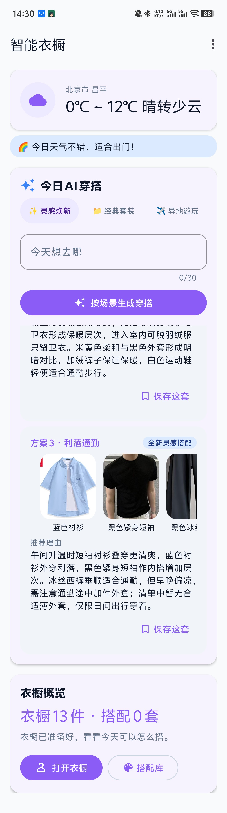
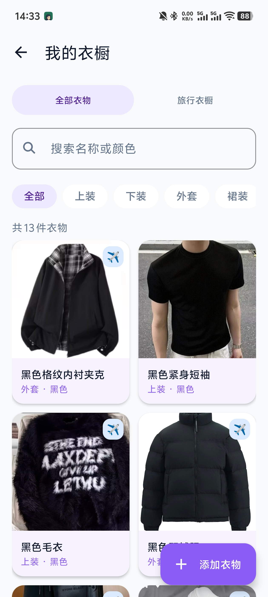
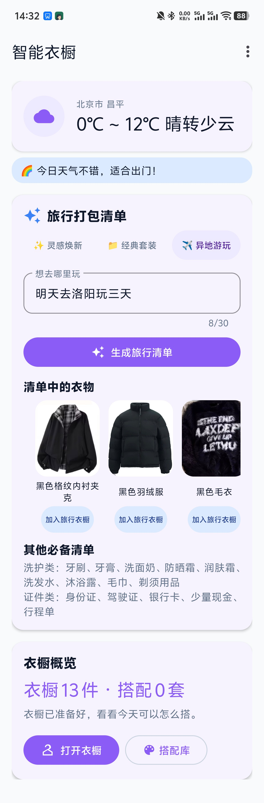
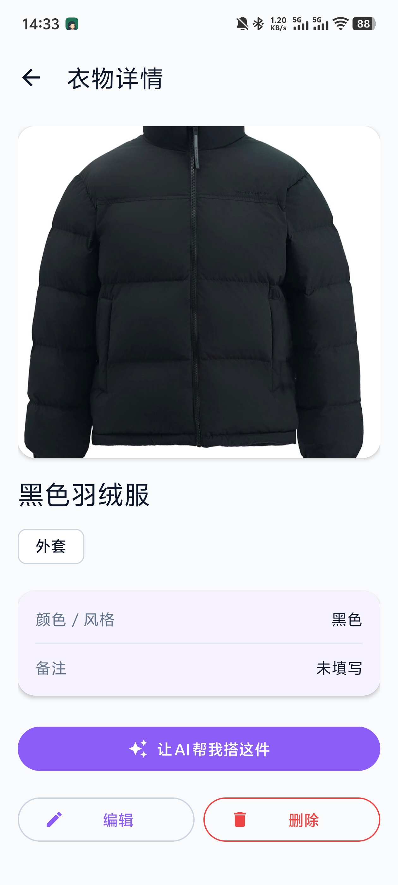
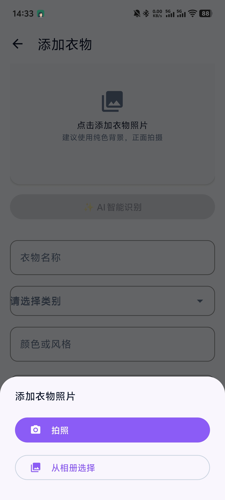
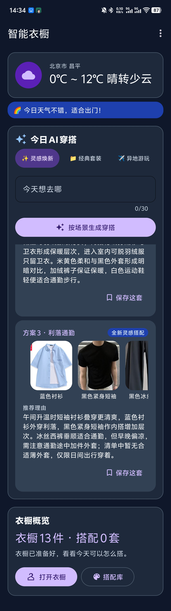

# 智能衣橱与 AI 穿搭助手

一个完全使用 Java 编写的 Android 穿搭助手：衣橱数据保存在本机 SQLite 中，结合定位天气与兼容 OpenAI Chat Completions 的大模型，生成适合当天、特定场景或旅行目的地的穿搭与打包建议。

当前版本：**2.1.6** · 最低系统：**Android 8.0（API 26）** · 安装包：[GitHub Releases](../../releases/latest)

## 功能概览

| 模块 | 能力 |
| --- | --- |
| 我的衣橱 | 拍照/相册录入、自由裁剪、分类筛选、名称/颜色模糊搜索、编辑删除 |
| 智能录入 | AI 视觉识别名称、类别和颜色；后台生成仅供 AI 使用的衣物描述 |
| 天气 | 和风天气每日预报、逆地理编码、30 分钟缓存、下拉刷新、生活提示 |
| AI 穿搭 | 灵感焕新、经典套装、自定义场景、三套图文方案、独立保存 |
| 单品搭配 | 从详情页围绕一件衣物生成搭配，并匹配衣橱图片 |
| 异地游玩 | 解析城市与日期，结合 7 天预报生成打包清单和旅行穿搭 |
| 旅行衣橱 | 逐件加入/移出、跨页面同步、旅行结束后一键清空 |
| 搭配库 | 保存文字、天气快照和关联衣物，展示图片，支持删除与去重 |
| 个性化 | 性别偏好、浅色/深色/跟随系统、API 配置、数据迁移 |

## 界面预览

| 首页 | 我的衣橱 | 异地游玩 |
| --- | --- | --- |
|  |  |  |

| 衣物详情 | 添加衣物 | 深色模式 |
| --- | --- | --- |
|  |  |  |

| 设置 |
| --- |
|  |

截图使用测试数据，设置页中的天气 Host 已替换为示例地址。

## 技术架构

```text
Activity（只渲染 UiState、处理权限与页面跳转）
    ↓
ViewModel（MainViewModel / WardrobeViewModel / ItemDetailViewModel）
    ↓
Repository（OutfitRepository / WeatherRepository / WardrobeRepository）
    ↓
SQLite · LocationManager · 和风天气 · OpenAI 兼容 LLM
```

- 纯 Java + Material Components 3，Activity 生命周期管理，不使用 Compose。
- 原生 `SQLiteOpenHelper` 管理衣橱、搭配和关联表，数据库只保存图片文件名。
- Retrofit + Gson + OkHttp 处理天气与大模型请求，支持动态 Base URL。
- Glide 加载应用私有目录图片，缺失图片使用本地占位图。
- 所有网络请求异步执行，页面销毁时取消 Call；保存、生成、旅行衣橱操作均有防连点处理。

## 项目结构

```text
.
├─ Wardrobe/                 Android Studio 工程
│  ├─ app/src/main/          Java 源码、布局、主题与资源
│  ├─ app/src/test/          JVM 单元测试
│  └─ signing/               签名说明（真实密钥不提交）
├─ docs/                     使用说明与截图
├─ outputs/                  当前版本校验文件（APK 由 Releases 提供）
├─ .github/                  CI 与 Issue 模板
├─ README.md
├─ CHANGELOG.md
├─ SECURITY.md
└─ PRIVACY.md
```

## 编译运行

### 环境要求

- Android Studio（推荐最新稳定版）或 Android SDK
- JDK 25（本项目 Android Gradle Plugin 9.x 的构建要求）
- Android SDK Platform 37 与 Build Tools 36.0.0

### Android Studio

1. 克隆仓库。
2. 用 Android Studio 打开 `Wardrobe/` 目录。
3. 等待 Gradle Sync 完成。
4. 选择 `app` 运行配置并启动模拟器或真机。

### 命令行

macOS / Linux：

```bash
cd Wardrobe
./gradlew testDebugUnitTest assembleDebug --console=plain
```

Windows PowerShell：

```powershell
cd Wardrobe
.\gradlew.bat testDebugUnitTest assembleDebug --console=plain
```

Debug APK 输出：`Wardrobe/app/build/outputs/apk/debug/app-debug.apk`

### 生成正式版

正式版需要本地 Release 签名。复制示例配置并填写自己的签名信息：

```bash
cp keystore.example.properties keystore.properties
```

```properties
storeFile=signing/your-release.jks
storePassword=your-store-password
keyAlias=your-key-alias
keyPassword=your-key-password
```

然后运行：

```bash
cd Wardrobe
./gradlew packageDual --console=plain
```

未提供签名配置时可正常执行 `assembleDebug` 和单元测试，但 `assembleRelease` 会生成未签名 APK，不能直接用于覆盖升级。

## 配置服务

应用源码不包含真实 API Key。安装后进入首页右上角菜单 → 设置，填写：

- 和风天气 Host
- 和风天气 Key
- LLM Base URL
- LLM API Key
- LLM Model Name

LLM Base URL 可以填写服务根地址，应用会自动补齐 `/chat/completions`；也可以填写完整接口地址。不同厂商支持的模型和视觉能力不同，请在设置中使用服务商实际提供的模型名。

## 数据库

数据库 `wardrobe.db` 包含：

- `wardrobe_items`：衣物名称、类别、图片文件名、颜色、备注、AI 隐藏描述、旅行衣橱标记和时间戳。
- `outfits`：搭配标题、正文、来源、天气快照、温度与创建时间。
- `outfit_items`：搭配与衣物的多对多关联。

图片仅以文件名入库，读取时通过 `ImageStore` 拼接应用私有目录，支持覆盖安装与换机迁移。

## 安装与升级

正式版包名为 `com.example.wardrobe`，Beta 包名为 `com.example.wardrobe.beta`，两者可共存且数据独立。

从 GitHub Releases 下载：

- `SmartWardrobe-v2.1.6-release.apk`：正式版，可使用同一签名的旧正式版直接覆盖升级。
- `SmartWardrobe-v2.1.6-beta.final.apk`：最终测试版，详情页额外显示 AI 隐藏描述。

```bash
adb install -r SmartWardrobe-v2.1.6-release.apk
```

安装包校验值见 [`outputs/`](outputs/) 中的 `.sha256` 文件，或使用：

```bash
sha256sum -c outputs/SmartWardrobe-v2.1.6-release.apk.sha256
```

## 测试

```bash
cd Wardrobe
./gradlew testDebugUnitTest lintDebug assembleDebug --console=plain
```

当前基线包含 54 项 JVM 单元测试，覆盖 Prompt 构建、AI 输出清洗与解析、天气 DTO、缓存日期、穿搭状态和衣物识别结果解析。

## 隐私与安全

- 衣橱、搭配、图片和 API 配置默认只保存在本机。
- 定位坐标会发送到和风天气用于天气与地名查询。
- 衣物图片与文本只在用户主动使用 AI 功能时发送给所配置的大模型服务。
- 迁移 ZIP 包含衣橱、搭配和图片，不包含 API Key。

完整说明见 [PRIVACY.md](PRIVACY.md) 和 [SECURITY.md](SECURITY.md)。

## 文档

- [使用说明](docs/使用说明.md)
- [更新日志](CHANGELOG.md)
- [隐私说明](PRIVACY.md)
- [安全策略](SECURITY.md)

## 版本规则

版本号遵循 [Semantic Versioning](https://semver.org/lang/zh-CN/)：新增向后兼容功能提升 `MINOR`，修复提升 `PATCH`，不兼容变更提升 `MAJOR`。版本统一维护在 `Wardrobe/gradle.properties`。

## 许可证

本项目采用 [MIT License](LICENSE)。
